| Information                   | Details                          |
| :---------------------------- | :------------------------------- |
| Student Name                  | MENDA LAKSHMANARAO               |
| Student Registration Number   | 252U1R5100                       |
| Class & Section               | 313 AI DE 2B                     |
| Study Level : UG/PG/Doctorate | UG                               |
| Year & Term                   | 2 & 2                            |
| Subject Name                  | Backend Development Fundamentals |
| Teacher / Faculty Name        | Mr Yugandhar Gurjalwar           |
| Name of the Assessment        | LAB REPORT - 3                   |
| Date of Submission            | 6/11/2026                        |

---

# Lab 3: REST API, query parameters, validation, debugging

## Objective

Build a robust, clean REST API for book management using Express and SQLite. Implement query parameter support for title search (`LIKE`), dynamic ordering (`order_by`, `order`), price range filtering (`min_price`, `max_price`), pagination (`limit`, `offset`), comprehensive request body validation, parameterized queries for SQL injection prevention, and standardized HTTP response codes and error formats. Practice identifying and resolving common backend bugs including port collisions, import path errors, schema typos, and unhandled asynchronous promises.

---

## How to Run

### Prerequisites
- Node.js (v18 or higher)
- npm

### 1. Installation
Navigate into the `lab-03` directory and install project dependencies:
```bash
cd lab-03
npm install
```

### 2. Database Setup & Seeding
Run the database setup script to create the `book` table in `books.db` and insert 10 sample books:
```bash
npm run setup-db
```

### 3. Start the Server
- Run the server in standard mode:
  ```bash
  npm start
  ```
- Run the server in development mode (with auto-restart via Nodemon):
  ```bash
  npm run dev
  ```
The API server starts listening at `http://localhost:3000/`.

---

## Endpoints Table

| Method | Endpoint | Query Parameters / Body | Description | Success Status | Error Status |
| :--- | :--- | :--- | :--- | :---: | :---: |
| `GET` | `/books/` | `search_q`, `order_by`, `order`, `limit`, `offset`, `min_price`, `max_price` | Retrieve books with optional search, sorting, filtering, and pagination | `200 OK` | `400 Bad Request` |
| `GET` | `/books/:bookId/` | Path parameter: `bookId` | Retrieve details of a single book by ID | `200 OK` | `404 Not Found` |
| `POST` | `/books/` | Body: `{ title, author, price, pages }` | Add a new book record with required title, author, and numeric price | `201 Created` | `400 Bad Request` |
| `PUT` | `/books/:bookId/` | Path parameter: `bookId`<br>Body: `{ title, author, price, pages }` | Update details of an existing book record | `200 OK` | `400 / 404 Not Found` |
| `DELETE` | `/books/:bookId/` | Path parameter: `bookId` | Remove a book record from the database by ID | `200 OK` | `404 Not Found` |

### Query Parameters for `GET /books/`

| Parameter | Type | Default Value | Description |
| :--- | :--- | :---: | :--- |
| `search_q` | String | `""` | Filter books whose title contains the query string (SQL `LIKE %search_q%`) |
| `order_by` | String | `'id'` | Column to sort results by (`id`, `title`, `author`, `price`, `pages`) |
| `order` | String | `'ASC'` | Sorting order direction (`ASC` or `DESC`) |
| `limit` | Integer | `10` | Maximum number of book records to return |
| `offset` | Integer | `0` | Number of book records to skip for pagination |
| `min_price`| Number | *None* | Lower bound filter for book price (`price >= min_price`) |
| `max_price`| Number | *None* | Upper bound filter for book price (`price <= max_price` / `BETWEEN`) |

---

## Code Files

### `package.json`
```json
{
  "name": "lab-03-rest-api",
  "version": "1.0.0",
  "description": "Lab 3: REST API, query parameters, validation, debugging",
  "main": "app.js",
  "scripts": {
    "start": "node app.js",
    "dev": "nodemon app.js",
    "setup-db": "node setupDb.js"
  },
  "dependencies": {
    "express": "^4.19.2",
    "sqlite": "^5.1.1",
    "sqlite3": "^5.1.7"
  },
  "devDependencies": {
    "nodemon": "^3.1.4"
  }
}
```

### `setupDb.js`
```javascript
const path = require('path')
const sqlite3 = require('sqlite3')
const { open } = require('sqlite')

const dbPath = path.join(__dirname, 'books.db')

const setupDb = async () => {
  try {
    const db = await open({
      filename: dbPath,
      driver: sqlite3.Database,
    })

    await db.exec(`
      DROP TABLE IF EXISTS book;
      CREATE TABLE book (
        id INTEGER PRIMARY KEY AUTOINCREMENT,
        title TEXT NOT NULL,
        author TEXT NOT NULL,
        price INTEGER NOT NULL,
        pages INTEGER NOT NULL
      );
    `)

    await db.exec(`
      INSERT INTO book (title, author, price, pages) VALUES
        ('The Alchemist', 'Paulo Coelho', 350, 208),
        ('Wings of Fire', 'A. P. J. Abdul Kalam', 425, 180),
        ('The Hobbit', 'J. R. R. Tolkien', 550, 310),
        ('Pride and Prejudice', 'Jane Austen', 300, 432),
        ('The White Tiger', 'Aravind Adiga', 399, 321),
        ('Sapiens', 'Yuval Noah Harari', 650, 498),
        ('The Guide', 'R. K. Narayan', 275, 220),
        ('A Brief History of Time', 'Stephen Hawking', 475, 256),
        ('Atomic Habits', 'James Clear', 520, 320),
        ('The Great Gatsby', 'F. Scott Fitzgerald', 380, 180);
    `)

    const books = await db.all('SELECT * FROM book;')
    console.log(`Seeded ${books.length} books successfully.`)
    console.table(books)

    await db.close()
  } catch (error) {
    console.error('Database setup failed:', error.message)
    process.exit(1)
  }
}

if (require.main === module) {
  setupDb()
}

module.exports = { setupDb }
```

### `app.js`
```javascript
const path = require('path')
const express = require('express')
const sqlite3 = require('sqlite3')
const { open } = require('sqlite')

const app = express()
const port = process.env.PORT || 3000
const dbPath = path.join(__dirname, 'books.db')

let db = null

app.use(express.json())

const ALLOWED_ORDER_BY = ['id', 'title', 'author', 'price', 'pages']
const ALLOWED_ORDER = ['ASC', 'DESC']

app.get('/books/', async (request, response) => {
  try {
    const {
      search_q = '',
      order_by = 'id',
      order = 'ASC',
      limit = '10',
      offset = '0',
      min_price,
      max_price,
    } = request.query

    const safeOrderBy = ALLOWED_ORDER_BY.includes(order_by.toLowerCase())
      ? order_by.toLowerCase()
      : 'id'
    const safeOrder = ALLOWED_ORDER.includes(order.toUpperCase())
      ? order.toUpperCase()
      : 'ASC'

    const parsedLimit = parseInt(limit, 10)
    const parsedOffset = parseInt(offset, 10)

    if (isNaN(parsedLimit) || parsedLimit < 1) {
      return response.status(400).json({ message: 'Invalid limit value' })
    }

    if (isNaN(parsedOffset) || parsedOffset < 0) {
      return response.status(400).json({ message: 'Invalid offset value' })
    }

    const conditions = ['title LIKE ?']
    const params = [`%${search_q}%`]

    if (min_price !== undefined && max_price !== undefined) {
      const min = Number(min_price)
      const max = Number(max_price)
      if (isNaN(min) || isNaN(max)) {
        return response.status(400).json({ message: 'Invalid price range' })
      }
      conditions.push('price BETWEEN ? AND ?')
      params.push(min, max)
    } else if (min_price !== undefined) {
      const min = Number(min_price)
      if (isNaN(min)) {
        return response.status(400).json({ message: 'Invalid min_price' })
      }
      conditions.push('price >= ?')
      params.push(min)
    } else if (max_price !== undefined) {
      const max = Number(max_price)
      if (isNaN(max)) {
        return response.status(400).json({ message: 'Invalid max_price' })
      }
      conditions.push('price <= ?')
      params.push(max)
    }

    const whereClause = conditions.length > 0 ? `WHERE ${conditions.join(' AND ')}` : ''
    const getBooksQuery = `
      SELECT * FROM book
      ${whereClause}
      ORDER BY ${safeOrderBy} ${safeOrder}
      LIMIT ? OFFSET ?;
    `
    params.push(parsedLimit, parsedOffset)

    const books = await db.all(getBooksQuery, params)
    response.status(200).json(books)
  } catch (error) {
    response.status(500).json({ message: 'Internal Server Error' })
  }
})

app.get('/books/:bookId/', async (request, response) => {
  try {
    const { bookId } = request.params
    const book = await db.get('SELECT * FROM book WHERE id = ?;', [bookId])

    if (!book) {
      return response.status(404).json({ message: 'Book Not Found' })
    }

    response.status(200).json(book)
  } catch (error) {
    response.status(500).json({ message: 'Internal Server Error' })
  }
})

app.post('/books/', async (request, response) => {
  try {
    const { title, author, price, pages } = request.body

    if (!title || typeof title !== 'string' || !title.trim()) {
      return response.status(400).json({ message: 'Missing title' })
    }

    if (!author || typeof author !== 'string' || !author.trim()) {
      return response.status(400).json({ message: 'Missing author' })
    }

    if (price === undefined || price === null || isNaN(Number(price)) || Number(price) < 0) {
      return response.status(400).json({ message: 'Invalid or missing price' })
    }

    const parsedPages = pages !== undefined && pages !== null ? parseInt(pages, 10) : 0
    if (isNaN(parsedPages) || parsedPages < 0) {
      return response.status(400).json({ message: 'Invalid pages value' })
    }

    const insertBookQuery = `
      INSERT INTO book (title, author, price, pages)
      VALUES (?, ?, ?, ?);
    `
    const result = await db.run(insertBookQuery, [
      title.trim(),
      author.trim(),
      Number(price),
      parsedPages,
    ])

    response.status(201).json({
      bookId: result.lastID,
      message: 'Book Added Successfully',
    })
  } catch (error) {
    response.status(500).json({ message: 'Internal Server Error' })
  }
})

app.put('/books/:bookId/', async (request, response) => {
  try {
    const { bookId } = request.params
    const { title, author, price, pages } = request.body

    const existingBook = await db.get('SELECT * FROM book WHERE id = ?;', [bookId])
    if (!existingBook) {
      return response.status(404).json({ message: 'Book Not Found' })
    }

    if (title !== undefined && (typeof title !== 'string' || !title.trim())) {
      return response.status(400).json({ message: 'Invalid title' })
    }

    if (author !== undefined && (typeof author !== 'string' || !author.trim())) {
      return response.status(400).json({ message: 'Invalid author' })
    }

    if (price !== undefined && (isNaN(Number(price)) || Number(price) < 0)) {
      return response.status(400).json({ message: 'Invalid price' })
    }

    const updatedTitle = title !== undefined ? title.trim() : existingBook.title
    const updatedAuthor = author !== undefined ? author.trim() : existingBook.author
    const updatedPrice = price !== undefined ? Number(price) : existingBook.price
    const updatedPages = pages !== undefined ? parseInt(pages, 10) : existingBook.pages

    const updateBookQuery = `
      UPDATE book
      SET title = ?, author = ?, price = ?, pages = ?
      WHERE id = ?;
    `
    await db.run(updateBookQuery, [updatedTitle, updatedAuthor, updatedPrice, updatedPages, bookId])

    response.status(200).json({ message: 'Book Updated Successfully' })
  } catch (error) {
    response.status(500).json({ message: 'Internal Server Error' })
  }
})

app.delete('/books/:bookId/', async (request, response) => {
  try {
    const { bookId } = request.params
    const existingBook = await db.get('SELECT * FROM book WHERE id = ?;', [bookId])
    if (!existingBook) {
      return response.status(404).json({ message: 'Book Not Found' })
    }

    await db.run('DELETE FROM book WHERE id = ?;', [bookId])
    response.status(200).json({ message: 'Book Deleted Successfully' })
  } catch (error) {
    response.status(500).json({ message: 'Internal Server Error' })
  }
})

const initializeDBAndServer = async () => {
  try {
    db = await open({
      filename: dbPath,
      driver: sqlite3.Database,
    })

    await db.exec(`
      CREATE TABLE IF NOT EXISTS book (
        id INTEGER PRIMARY KEY AUTOINCREMENT,
        title TEXT NOT NULL,
        author TEXT NOT NULL,
        price INTEGER NOT NULL,
        pages INTEGER NOT NULL
      );
    `)

    app.listen(port, () => {
      console.log(`Server Running at http://localhost:${port}/`)
    })
  } catch (error) {
    console.error(`DB Error: ${error.message}`)
    process.exit(1)
  }
}

initializeDBAndServer()

module.exports = app
```

---

## Output & Screenshots

### 1. Default GET Books (`GET /books/`)
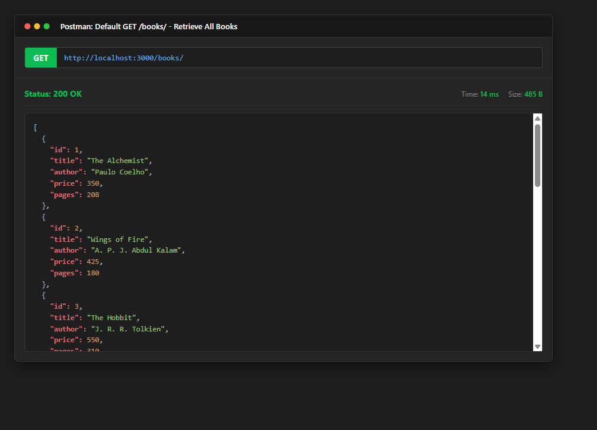

### 2. Search Query (`GET /books/?search_q=the`)
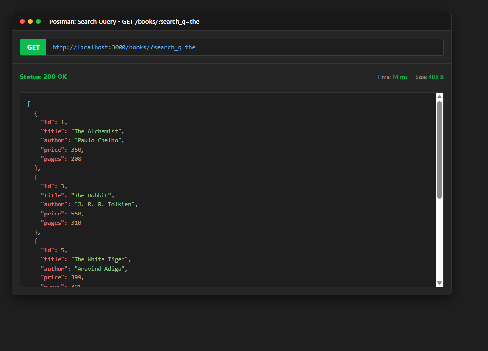

### 3. Price Range Filter (`GET /books/?min_price=300&max_price=600`)
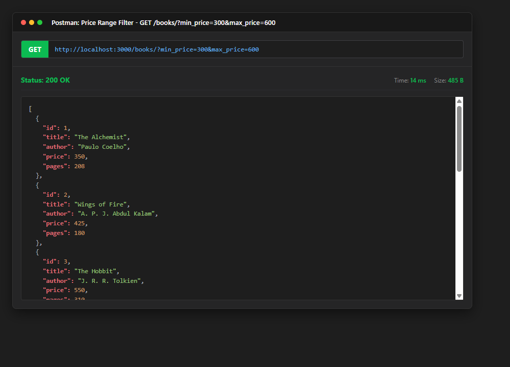

### 4. Sorting & Pagination (`GET /books/?order_by=price&order=DESC&limit=4`)
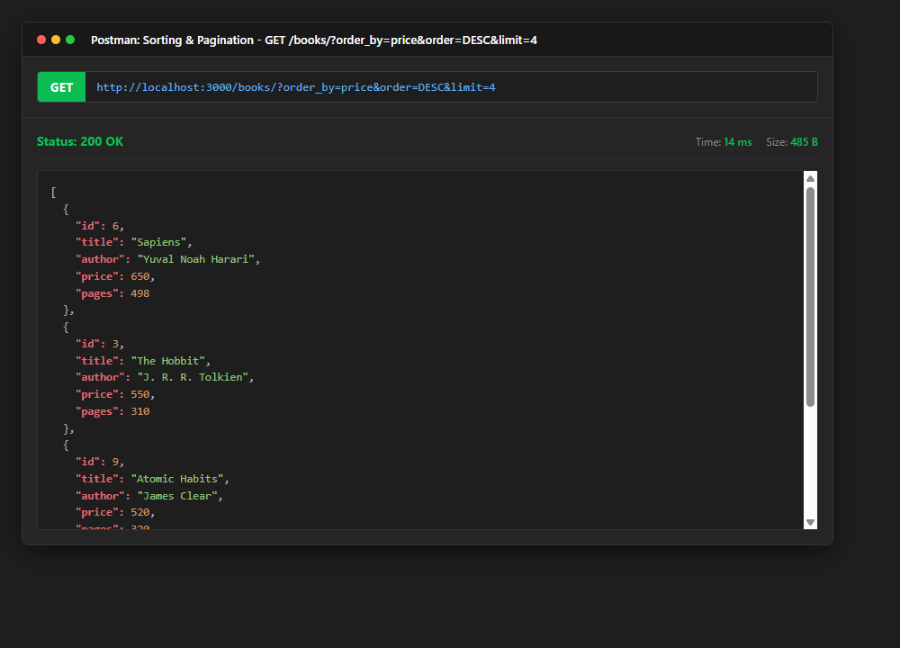

### 5. GET Single Book (`GET /books/1/`)
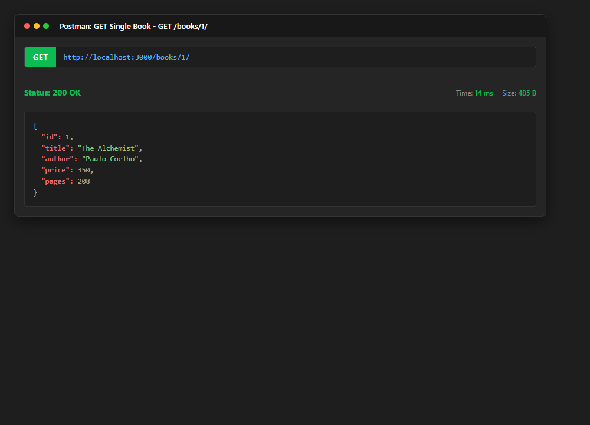

### 6. GET 404 Error Case (`GET /books/999/`)
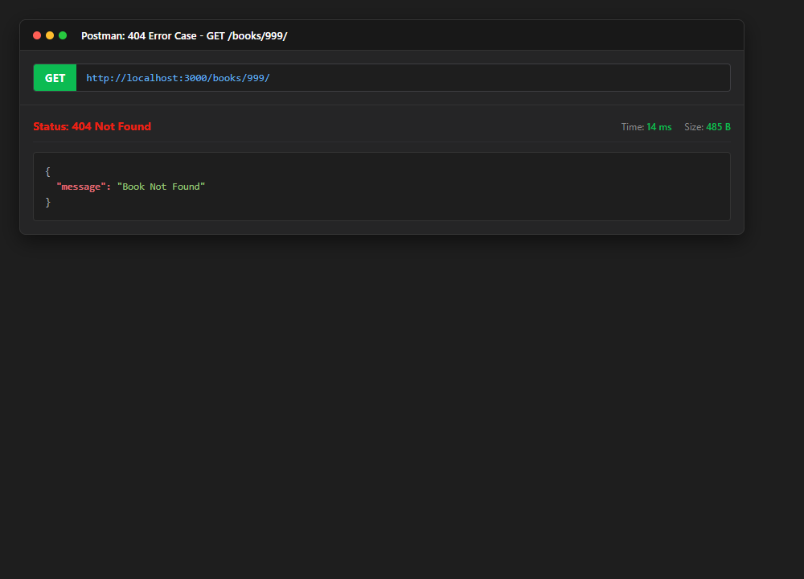

### 7. POST Add Book Success (`POST /books/` - 201 Created)
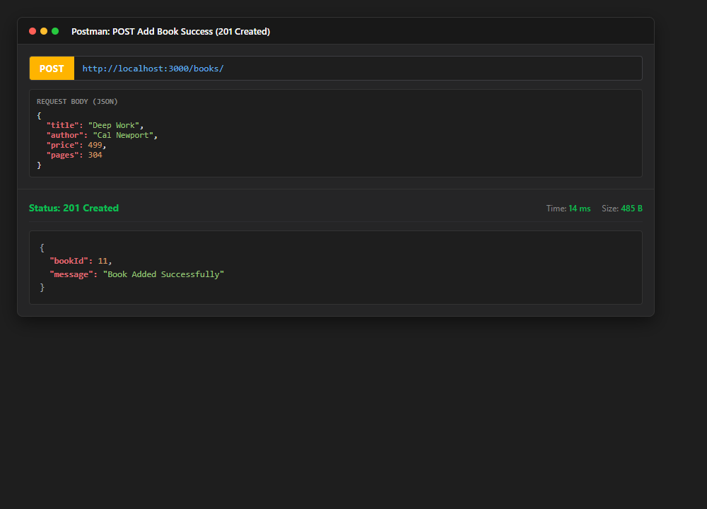

### 8. POST Missing Title Error (`POST /books/` - 400 Bad Request)
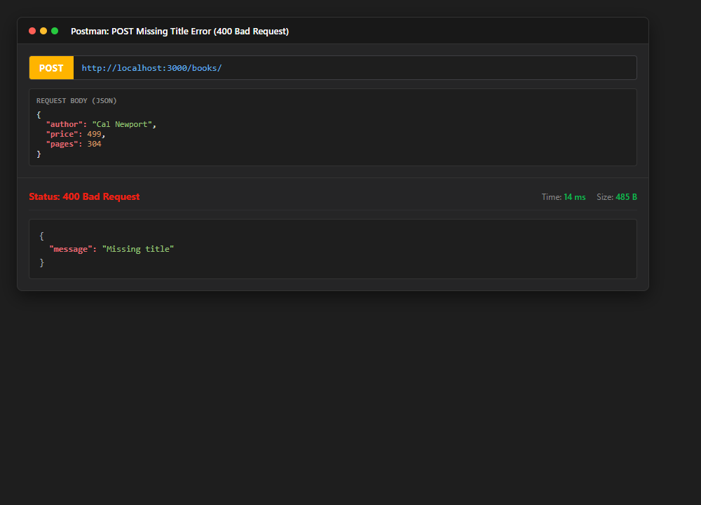

### 9. POST Non-numeric Price Error (`POST /books/` - 400 Bad Request)
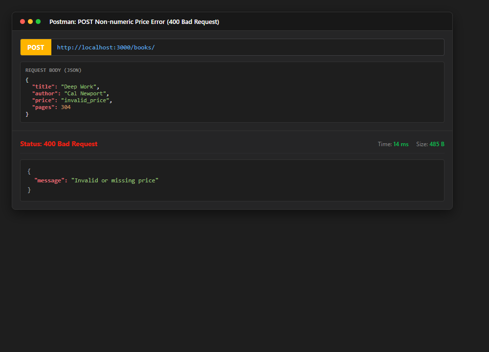

### 10. PUT Update Success (`PUT /books/1/` - 200 OK)
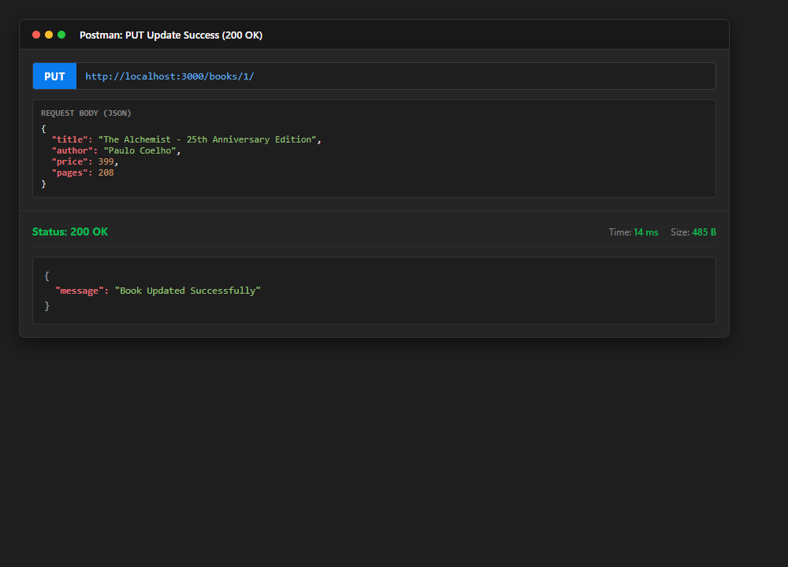

### 11. PUT Not Found (`PUT /books/999/` - 404 Not Found)
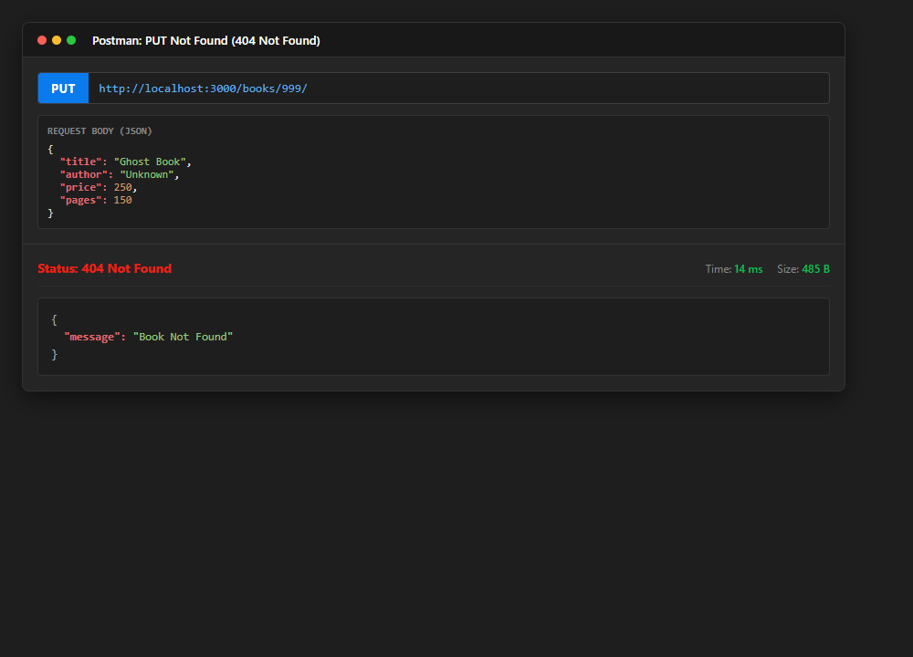

### 12. DELETE Success (`DELETE /books/10/` - 200 OK)
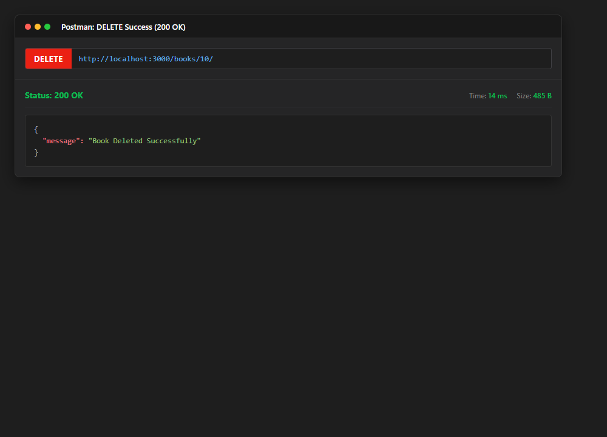

### 13. DELETE Not Found (`DELETE /books/999/` - 404 Not Found)
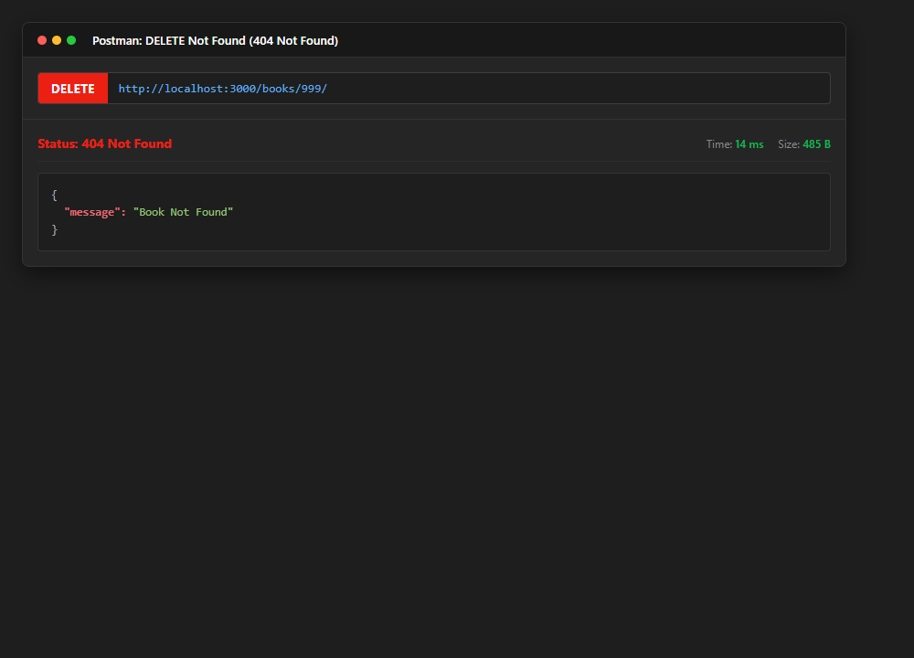

### 14. SQLite CLI Table View (Database Changes Before & After)
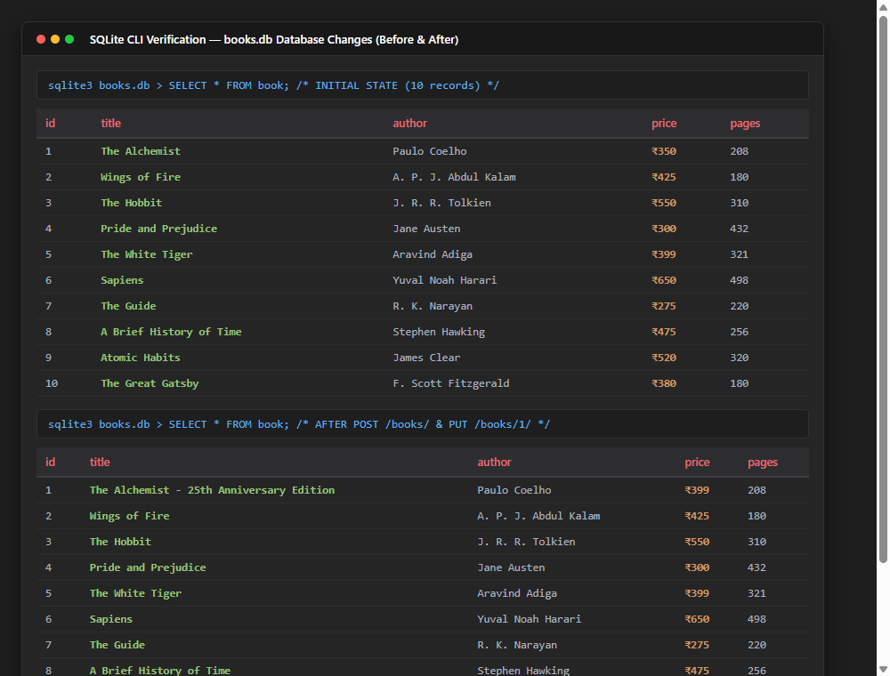

---

## Viva Questions & Answers

### 1. Query parameter vs path parameter?
- **Path parameters** (e.g., `/books/:bookId/`) are part of the hierarchical URL path and are designed to uniquely identify a specific resource in the collection.
- **Query parameters** (e.g., `/books/?search_q=the&order_by=price`) are optional key-value pairs appended after the `?` symbol in the URL. They are used to filter, sort, search, or paginate a collection of resources without altering the resource endpoint.

### 2. What does stateless mean in REST?
- **Statelessness** is a core architectural constraint of REST. It means that the server retains no client session context between requests. Every HTTP request sent from the client must include all the information required to authenticate, understand, and fulfill that request. This ensures independent request processing, high reliability, and horizontal scalability.

### 3. Which status code for bad input vs a missing record?
- **Bad Input (`400 Bad Request`):** Used when the client provides invalid, malformed, or missing input data (for example, missing required `title`/`author` fields, non-numeric price, or invalid query options).
- **Missing Record (`404 Not Found`):** Used when the request syntax is completely valid, but the requested resource (such as a book with `bookId = 999`) does not exist in the database.

---

## Debugging Notes

1. **Port Conflict (`EADDRINUSE`)**:
   - **Cause:** Occurs when Node.js tries to bind to port 3000 while another instance of the server or another local service is already listening on the same port.
   - **Resolution:** Configured `const port = process.env.PORT || 3000` to allow overriding the port via environment variables. Stopped lingering Node background processes using task manager or PowerShell (`Stop-Process -Id (Get-NetTCPConnection -LocalPort 3000).OwningProcess -Force`).

2. **Wrong Import Path**:
   - **Cause:** Incorrect relative paths when importing modules or database files across directory levels, or attempting to `require()` SQLite database binary files directly instead of passing the resolved file path string to the SQLite driver.
   - **Resolution:** Used Node.js built-in `path.join(__dirname, 'books.db')` to construct reliable, platform-independent absolute file paths, and correctly imported `{ open }` from `sqlite` alongside `sqlite3.Database`.

3. **Table-Name Typo (`no such table`)**:
   - **Cause:** SQL queries targeting `books` (plural) when the database schema definition created the table as `book` (singular), resulting in `SQLITE_ERROR: no such table: books`.
   - **Resolution:** Standardized table references to `book` across all SQL statements in `app.js` and `setupDb.js`. Added `CREATE TABLE IF NOT EXISTS book (...)` during server initialization to ensure the table schema exists before any route requests execute.

4. **Missing `await`**:
   - **Cause:** Omitting the `await` keyword before asynchronous database operations (`db.all()`, `db.get()`, `db.run()`). This causes the function to return a pending Promise instead of the resolved dataset, leading to empty JSON responses or race conditions.
   - **Resolution:** Declared all Express route handlers as `async (request, response) => { ... }` and strictly prepended every database call with `await` so data retrieval and mutations complete before the HTTP response is dispatched.
